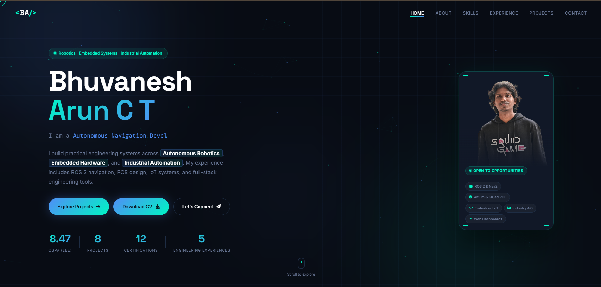

# Bhuvanesh Arun C T

Electrical & Electronics Engineering Student | Robotics & ROS2 | Industrial Automation | IoT | Embedded Systems | Renewable Energy

## Portfolio Website
🌐 Live Website: https://bhuvi-777.github.io/

## Preview

## About Me
Final-year Electrical and Electronics Engineering student at Chennai Institute of Technology (2023–2027, CGPA 8.47). I build and deploy working systems from scratch across robotics, industrial automation, IoT and embedded domains, from ROS2 navigation stacks on autonomous mobile robots to production dashboards on factory floors.

**Focus areas**

- Robotics & ROS2 / Nav2
- Industrial Automation
- IoT Development & Dashboards
- Embedded Systems & Firmware Tooling
- Renewable Energy & Power Quality
- AI & Machine Learning

## Experience

### Schneider Electric, Bangalore: Intern
- Built and deployed ten operational systems in a production environment
- Python PDF data-extraction pipeline for CAD-exported engineering drawings (OCR with PyMuPDF + Tesseract, section-aware output)
- Selenium-based firmware upgrade automation tool for the PM5561 power meter
- Node.js manufacturing traceability app with a streaming Excel export pipeline
- Node-RED panel door monitoring dashboard covering 15 production lines
- SQL Server reporting queries for manufacturing databases

### Previous Internships
- PICABORD Technologies
- Meera Laser Solutions
- Renom Wind Energy
- Vels Wind Power

## Featured Projects

### MiR200 AMR: ROS2 Modernization & FMS Dashboard
- ROS2 Nav2 stack with SLAM Toolbox mapping and EKF sensor fusion
- Tuned navigation using SmacPlannerHybrid and RegulatedPurePursuitController
- Topological / route-graph navigation with an Express backend
- BLE battery management (BMS) node for a JDB battery system
- Roboteq motor controller integration and fault recovery
- Browser-based Fleet Management System dashboard using roslibjs / ros2djs with a custom map rendering pipeline

### IoT Smart Energy Meter with Theft Detection
- ESP32 with PZEM-004T / SCT-013 energy sensing
- MQTT telemetry with a FastAPI backend
- Hardware BOM, circuit design and system block diagrams

### AI-Powered Self-Healing Microgrid
- Renewable energy integration
- Edge computing
- Vehicle-to-Grid (V2G)

### Automated Water Tank Overflow Prevention System
- ESP32-based IoT monitoring
- Real-time water level control
- Patent application submitted

### IoT-Based NPK Nutrient Analysis Kit
- ESP32 + color sensor
- Web dashboard monitoring
- Precision agriculture application

### Lunar Rocker-Bogie Rover
- Built for the Caterpillar Autonomy Challenge

## Publication

**Power quality challenges and resilient mitigation strategies for high-penetration electric vehicle integration: A comprehensive grid-centric review**
Lead author, *Energy Exploration & Exploitation* (SAGE), August 2026
🔗 https://doi.org/10.1177/01445987261483203

## Technical Skills

| Area | Tools |
|---|---|
| Languages | Python, C/C++, JavaScript (Node.js), SQL, MATLAB |
| Robotics | ROS2, Nav2, SLAM Toolbox, EKF, roslibjs |
| Embedded & IoT | ESP32, Arduino, MQTT, BLE, serial protocols, PCB design |
| Web & Backend | Flask, FastAPI, Express, Node-RED |
| Automation | Selenium, OCR (Tesseract, PyMuPDF), PLC fundamentals (CODESYS, Factory IO, in progress) |
| Machine Learning | Applied ML for energy and automation |

## Resume

📄 Download Resume:
[Resume PDF](./BHUVANESH%20ARUN%20C%20T%20resume.pdf)

## Contact

LinkedIn: https://linkedin.com/in/bhuvanesharunct

Email: bhuvanesharun777@gmail.com
