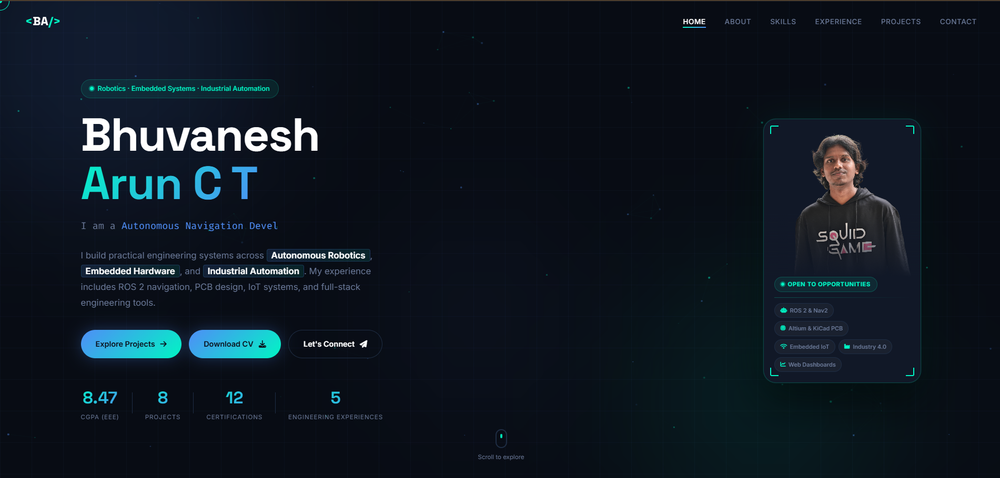

# Bhuvanesh Arun C T

Electrical & Electronics Engineering Student | Renewable Energy | Automation | Robotics | AI

## Portfolio Website
🌐 Live Website: https://bhuvi-777.github.io/

## Preview

## About Me
Passionate Electrical and Electronics Engineering student with experience in:

- Renewable Energy Systems
- Industrial Automation
- Robotics & ROS2
- AI & Machine Learning
- Embedded Systems
- IoT Development

## Featured Projects

### AI-Powered Self-Healing Microgrid
- Renewable energy integration
- Edge computing
- Vehicle-to-Grid (V2G)

### Automated Water Tank Overflow Prevention System
- ESP32-based IoT monitoring
- Real-time water level control
- Patent application submitted

### IoT-Based NPK Nutrient Analysis Kit
- ESP32 + Color Sensor
- Web dashboard monitoring
- Precision agriculture application

## Technical Skills

- Python
- C/C++
- ROS2
- MATLAB
- Arduino
- ESP32
- SQL
- Machine Learning

## Resume

📄 Download Resume:
[Resume PDF](./BHUVANESH%20ARUN%20C%20T%20resume.pdf)

## Contact

LinkedIn:
https://linkedin.com/in/bhuvanesharunct

Email:
bhuvanesharun777@gmail.com
